# CRISPRi-PseudoBrowser Architecture

This document describes the Django project structure, request routing, data flow, templates, JavaScript, static assets, persistence, and cross-app dependencies.

## Mermaid Architecture Diagram

```mermaid
flowchart LR
    Browser["Browser"]
    DB[(SQLite db.sqlite3)]
    Prepared["data_import/*.tsv<br/>Developer import artifacts"]
    CDN["External CDNs<br/>jQuery, DataTables, JSZip, Plotly"]
    CSS["static/css/main.css"]
    IMG["static/images/map-pin.svg"]
    WSGI["WSGI / ASGI entrypoints"]
    Middleware["Django middleware<br/>sessions, CSRF, auth, messages, security"]

    Browser --> WSGI --> Middleware
    Middleware --> RootURLs["crispriseq_browser/urls.py"]
    RootURLs --> Admin["Django Admin"]
    RootURLs --> HomeView["home view"]
    RootURLs --> GeneURLs["/gene/"]
    RootURLs --> GuidesURLs["/guides/"]
    RootURLs --> ConditionURLs["/condition/"]
    RootURLs --> PathwayURLs["/pathway/"]
    RootURLs --> CompareURLs["/compare/"]
    RootURLs --> DownloadsURLs["/downloads/"]
    RootURLs --> MismatchURLs["/mismatch/"]

    subgraph Gene["gene app"]
        GeneURLs --> GeneIndex["gene.views.index"]
        GeneURLs --> GeneDataAPI["POST get_gene_data"]
        GeneURLs --> GeneListAPI["GET get_gene_list_api"]
        GeneIndex --> GeneTemplate["gene/index.html"]
        GeneDataAPI --> GeneAnalysis["gene_analysis.prepare_gene_plot_data"]
        GeneListAPI --> DataLoader["gene.data_loader"]
        GeneIndex --> DataLoader
        GeneAnalysis --> DataLoader
        GeneModels["gene/models.py<br/>No app-owned models"]
    end

    subgraph Condition["condition app"]
        ConditionURLs --> ConditionIndex["condition.views.index"]
        ConditionURLs --> VolcanoAPI["POST get_volcano_data"]
        ConditionIndex --> ConditionTemplate["condition/index.html"]
        VolcanoAPI --> ConditionAnalysis["condition_analysis.prepare_volcano_data"]
        ConditionIndex --> ConditionAnalysis
        ConditionModels["condition/models.py<br/>No app-owned models"]
    end

    subgraph Pathway["pathway app"]
        PathwayURLs --> PathwayIndex["pathway.views.index"]
        PathwayURLs --> DatasetAPI["GET dataset-records"]
        PathwayURLs --> TermsAPI["GET terms"]
        PathwayURLs --> TermGenesAPI["POST term-genes"]
        PathwayURLs --> SyncAPI["POST sync-starred"]
        PathwayURLs --> StarredAPI["GET starred-genes"]
        PathwayIndex --> PathwayTemplate["pathway/index.html"]
        DatasetAPI --> DataLoader
        TermsAPI --> DataLoader
        TermGenesAPI --> DataLoader
        TermGenesAPI --> StarredModel
        SyncAPI --> StarredModel
        StarredAPI --> StarredModel
        StarredModel["StarredGene<br/>PAO1_ID, gene_name<br/>dataset/accession/term<br/>created_at, updated_at"]
        StarredModel --> DB
    end

    subgraph Compare["compare app"]
        CompareURLs --> CompareIndex["compare.views.index"]
        CompareURLs --> CompareStarredAPI["GET starred-genes"]
        CompareURLs --> RemoveAPI["POST remove-starred-gene"]
        CompareURLs --> HeatmapAPI["POST heatmap"]
        CompareIndex --> CompareTemplate["compare/index.html"]
        CompareStarredAPI --> StarredModel
        RemoveAPI --> StarredModel
        HeatmapAPI --> HeatmapAnalysis["heatmap_analysis.prepare_compare_heatmap_data"]
        HeatmapAPI --> StarredModel
        HeatmapAnalysis --> DataLoader
    end

    subgraph Guides["guides app"]
        GuidesURLs --> GuidesView["guides.views.index"]
        GuidesURLs --> GuidesDataAPI["GET /guides/api/data/"]
        GuidesView --> GuidesTemplate["guides/index.html<br/>Guide ranking table"]
        GuidesDataAPI --> DownloadsModels
    end

    subgraph Mismatch["mismatch app"]
        MismatchURLs --> MismatchIndex["mismatch.views.index"]
        MismatchURLs --> MismatchDataAPI["POST /mismatch/api/data/"]
        MismatchIndex --> MismatchTemplate["mismatch/index.html"]
        MismatchDataAPI --> MismatchAnalysis["mismatch.analysis.prepare_mismatch_data"]
        MismatchAnalysis --> DownloadsModels
    end

    subgraph Downloads["downloads app"]
        DownloadsURLs --> DownloadsView["downloads.views.index"]
        DownloadsView --> DownloadsTemplate["downloads/index.html<br/>On-demand Excel exports"]
        DownloadsModels["downloads/models.py<br/>Imported browser and pathway models"]
    end

    HomeView --> HomeTemplate["templates/home.html"]
    DataLoader --> DownloadsModels
    GeneAnalysis --> DownloadsModels
    ConditionAnalysis --> DownloadsModels
    HeatmapAnalysis --> DownloadsModels

    subgraph SharedTemplates["Shared template layer"]
        BaseTemplate["templates/base.html"]
        BaseTemplate --> CSS
        BaseTemplate --> IMG
        BaseTemplate --> CDN
        HomeTemplate --> BaseTemplate
        GeneTemplate --> BaseTemplate
        ConditionTemplate --> BaseTemplate
        PathwayTemplate --> BaseTemplate
        CompareTemplate --> BaseTemplate
        GuidesTemplate --> BaseTemplate
        DownloadsTemplate --> BaseTemplate
    end

    subgraph GeneBrowserJS["Gene browser JavaScript"]
        GeneAuto["gene_autocomplete.js"]
        GenePlot["gene_plot.js"]
        Slider["custom_slider.js"]
        GeneTemplate --> GeneAuto
        GeneTemplate --> GenePlot
        GeneTemplate --> Slider
        GeneAuto --> GeneListAPI
        GenePlot --> GeneDataAPI
        GenePlot --> CDN
        GeneAuto --> BrowserStorage["localStorage gene cache"]
    end

    subgraph ConditionJS["Condition browser JavaScript"]
        VolcanoJS["volcano_plot.js"]
        ConditionTemplate --> VolcanoJS
        ConditionTemplate --> Slider
        VolcanoJS --> VolcanoAPI
        VolcanoJS --> CDN
    end

    subgraph PathwayJS["Pathway browser JavaScript"]
        PathwayJSFile["pathway_browser.js"]
        PathwayTemplate --> PathwayJSFile
        PathwayJSFile --> DatasetAPI
        PathwayJSFile --> TermsAPI
        PathwayJSFile --> TermGenesAPI
        PathwayJSFile --> SyncAPI
        PathwayJSFile --> CDN
    end

    subgraph CompareJS["Compare browser JavaScript"]
        CompareJSFile["compare_browser.js"]
        CompareTemplate --> CompareJSFile
        CompareJSFile --> CompareStarredAPI
        CompareJSFile --> RemoveAPI
        CompareJSFile --> HeatmapAPI
        CompareJSFile --> CDN
    end

    CSS --> HomeTemplate
    CSS --> GeneTemplate
    CSS --> ConditionTemplate
    CSS --> PathwayTemplate
    CSS --> CompareTemplate
    CSS --> GuidesTemplate
    CSS --> DownloadsTemplate

    PathwayJSFile -. shared starred genes .-> CompareJSFile
    ConditionTemplate -. condition query parameters .-> GeneTemplate
    Compare --> Gene
    Pathway --> Compare
```

## Project Configuration

- `manage.py` is the Django command-line entry point.
- `crispriseq_browser/settings.py` configures Django 5.2, installed apps, middleware, templates, SQLite, and static files.
- `crispriseq_browser/urls.py` is the root router.
- `crispriseq_browser/wsgi.py` provides the WSGI application.
- `crispriseq_browser/asgi.py` provides the ASGI application.
- `templates/` is included as a project-level template directory.
- App templates are discovered through `APP_DIRS=True`.
- Static files are served from `static/` through `STATICFILES_DIRS`.
- `DEBUG=True` and `ALLOWED_HOSTS=['127.0.0.1']` indicate a development-oriented configuration.

## URL Routing

Root routes in `crispriseq_browser/urls.py`:

| Prefix | Included URL configuration | Purpose |
|---|---|---|
| `/admin/` | Django admin | Administration of registered models |
| `/` | `crispriseq_browser.views.home` | Home page |
| `/gene/` | `gene.urls` | Gene browser and APIs |
| `/guides/` | `guides.urls` | Guides ranking page and API |
| `/condition/` | `condition.urls` | Condition browser and volcano API |
| `/pathway/` | `pathway.urls` | Pathway browser and starred-gene APIs |
| `/compare/` | `compare.urls` | Starred-gene comparison and heatmap APIs |
| `/downloads/` | `downloads.urls` | On-demand database-backed Excel downloads |

### API Endpoints

#### Gene

- `GET /gene/api/gene-list/` returns autocomplete entries and gene-length limits.
- `POST /gene/api/get-gene-data/` accepts a gene, genomic window, and conditions, then returns target-gene, guide, region, and plot data.

#### Condition

- `POST /condition/api/get-volcano-data/` accepts condition, LFC threshold, and FDR threshold, then returns volcano plot records and metadata.

#### Pathway

- `GET /pathway/api/dataset-records/` returns records for the selected COG or GO dataset.
- `GET /pathway/api/terms/` searches terms by dataset and query.
- `POST /pathway/api/term-genes/` returns genes associated with a selected term and marks currently starred genes.
- `POST /pathway/api/sync-starred/` synchronizes checkbox selections with the database.
- `GET /pathway/api/starred-genes/` returns all starred genes.

#### Compare

- `GET /compare/api/starred-genes/` returns the shared starred-gene list.
- `POST /compare/api/remove-starred-gene/` removes one starred gene.
- `POST /compare/api/heatmap/` builds clustered heatmap data from starred genes across conditions.

## Data Flow

### Gene browser

1. `gene.views.index` loads available conditions and gene length limits from database-backed helpers.
2. The view renders `gene/index.html` with default gene, window, conditions, and slider bounds.
3. `gene_autocomplete.js` requests the gene-list API and caches the result in `localStorage` for up to 24 hours.
4. `gene_plot.js` submits the selected gene, window, and conditions to `get_gene_data`.
5. `gene_analysis.prepare_gene_plot_data` uses database-backed annotation and guide-observation queries and returns JSON-ready plot data.
6. Plotly renders genomic and guide-level plots; DataTables renders the guide table and CSV export controls.

### Condition browser

1. `condition.views.index` obtains available conditions from `condition_analysis` and renders defaults.
2. `volcano_plot.js` submits the selected condition and thresholds.
3. `condition_analysis.prepare_volcano_data` reads database summaries and prepares volcano records.
4. The JavaScript renders the Plotly volcano chart and a DataTables result table.
5. Condition selections can be forwarded to the Gene browser using query parameters.

### Pathway browser

1. `pathway.views.index` loads available pathway datasets through database-backed helpers.
2. `pathway_browser.js` requests dataset records and term suggestions.
3. Selecting a term calls `term-genes`, which combines database pathway associations with starred-state information.
4. Checkbox changes are submitted to `sync-starred`.
5. `StarredGene` rows are inserted, updated, or deleted in SQLite.
6. The browser uses DataTables for dataset records and links dataset terms back into the term-selection workflow.

### Compare browser

1. `compare.views.index` renders the comparison page.
2. `compare_browser.js` requests the shared starred-gene list.
3. Removal requests delete rows from `StarredGene`.
4. Heatmap requests load starred genes from SQLite and condition data through `gene.data_loader`.
5. `compare.heatmap_analysis` uses pandas, NumPy, and SciPy hierarchical clustering to create a heatmap matrix and dendrogram.
6. Plotly renders and exports the heatmap.

## Models and Database

The project uses SQLite at `db.sqlite3`.

The only project model is `pathway.StarredGene`:

- `PAO1_ID`: unique gene identifier.
- `gene_name`: optional gene name.
- `source_dataset`: pathway source such as COG or GO.
- `source_accession`: pathway accession.
- `source_term_name`: pathway term name.
- `created_at`: automatic creation timestamp.
- `updated_at`: automatic update timestamp.

The model is registered with Django admin in `pathway/admin.py`. The other app `models.py` files contain no concrete models.

## Imported Data and Preparation Files

Manuscript experimental data is imported into the Downloads app models from
the prepared TSV files under `data_import/prepared_browser/`. The preparation
files are no longer runtime sources for the migrated browser features:

- `condition_gene_data.tsv`: gene annotations, coordinates, conditions, median
  LFCs, Stouffer p-values, and fixed significance fields.
- `guide_data.tsv`: guide-level results, guide metadata, batch labels, and
  canonical model scores.
- `mismatch_data.tsv`: perfect and mismatch guide series.
- `comparison_manifest.tsv`: selected treatment and matched-control comparisons.

The original files under `data_import/edgeR_manuscript_subset/` are preparation
inputs, not runtime sources. The legacy `dataFiles/` experimental result files
and guide library are no longer used by the browser runtime. Pathway records
are also imported into `PathwayRecord`; the source files are required only by
the import command.

The remaining static pathway files are:

- `PAO1_cog.tsv`: COG pathway associations.
- `PAO1_gene_ontology.tsv`: GO pathway associations.
- `pathways.tsv`: pathway-related records.

The Downloads app exports the imported records as Excel workbooks through
`/downloads/`, including gene annotation, comparison manifest, guide metadata,
guide observations, gene-condition summaries, mismatch observations, COG, and
Gene Ontology records. Workbooks are generated only when requested by the
user; the Downloads page does not generate or size them during page loading.

Dataframes are cached in process memory by the loader. No background data-refresh service is present.

## Templates and Static Assets

All pages extend `templates/base.html`, which provides:

- Navigation links to every major app.
- Global CSS loading.
- CDN scripts and styles for jQuery, DataTables, DataTables Buttons, JSZip, and Plotly.
- Shared footer and contact information.
- Template blocks for page content, extra CSS, and extra JavaScript.

Page templates:

- `templates/home.html`: project landing/home page.
- `gene/templates/gene/index.html`: gene controls, plot containers, and guide table.
- `condition/templates/condition/index.html`: condition controls, volcano plot, and result table.
- `pathway/templates/pathway/index.html`: dataset selector, term search, linked genes, and dataset table.
- `compare/templates/compare/index.html`: starred-gene list and heatmap.
- `guides/templates/guides/index.html`: guide ranking controls and table.
- `downloads/templates/downloads/index.html`: database-backed Excel export controls and browser information.

JavaScript modules:

- `static/js/gene_autocomplete.js`: autocomplete, keyboard navigation, recent-item behavior, and localStorage caching.
- `static/js/gene_plot.js`: gene API calls, Plotly genomic plots, guide table creation, and plot/table downloads.
- `static/js/condition_plot.js` is not present; condition behavior is implemented by `static/js/volcano_plot.js`.
- `static/js/volcano_plot.js`: volcano API calls, threshold sliders, Plotly chart, and DataTables results.
- `static/js/pathway_browser.js`: dataset loading, term search, linked-gene selection, starred-gene synchronization, and pathway DataTables.
- `static/js/compare_browser.js`: starred-gene loading/removal, heatmap requests, dendrogram rendering, and plot download.
- `static/js/custom_slider.js`: shared numeric slider/input synchronization.

CSS is centralized in `static/css/main.css`, including layout, navigation, form controls, cards, plot areas, autocomplete menus, tables, DataTables customization, loading states, messages, and responsive behavior.

## External Libraries and Services

Python dependencies:

- Django
- pandas
- NumPy
- SciPy
- openpyxl
- python-dateutil

Browser dependencies loaded from CDNs:

- jQuery
- DataTables
- DataTables Buttons
- JSZip
- Plotly.js

There are no external application APIs, authentication providers, task queues, or cloud services. Footer links point to IBB PAS, GitHub, and email addresses but are not part of the application data flow.

## Middleware and Background Processing

Configured middleware includes:

- Security middleware.
- Session middleware.
- Common middleware.
- CSRF protection.
- Authentication middleware.
- Messages middleware.
- Clickjacking protection.

The repository contains no custom middleware, signals, Celery tasks, scheduled jobs, or asynchronous background processing. Excel workbooks are generated synchronously only when a user requests a download.

## Coupling Notes

- `pathway` owns the `StarredGene` model, but `compare.views` imports it directly from `pathway.models`.
- `gene.data_loader` is a shared database-backed query helper for Gene and Pathway.
- Compare’s heatmap depends on both persistent starred-gene records and Gene’s condition-result data.
- The Condition and Gene browsers are loosely coupled through query parameters and links.
- Templates inject endpoint URLs and CSRF tokens into global JavaScript variables.
- JavaScript is tightly coupled to template element IDs and those injected global variables.
- Plotly and DataTables are shared presentation dependencies loaded by the base template.
- Guides, Mismatch, Condition, Compare, and Downloads use the imported
  Downloads models for normal runtime data access. Downloads creates Excel
  workbooks synchronously when a user requests an export.
- Focused app tests cover the database-backed browser and export behavior.
